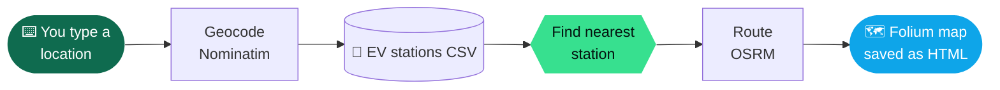

<div align="center">



<br/>

[](https://python.org)
[](https://python-visualization.github.io/folium/)
[](https://nominatim.org/)
[](LICENSE)


**Type any place in India. Get the nearest EV charging station and a driving route to it, on an interactive map.**

[✨ Features](#-features) &nbsp;•&nbsp;
[🚀 Quick Start](#-quick-start) &nbsp;•&nbsp;
[🔬 How It Works](#-how-it-works) &nbsp;•&nbsp;
[🏗️ Project Structure](#%EF%B8%8F-project-structure) &nbsp;•&nbsp;
[🗺️ Roadmap](#%EF%B8%8F-roadmap)

</div>

<!--
  Add a screenshot of a generated map here:
  <div align="center"></div>
-->

<br/>

## 🌟 At a Glance

<table align="center">
  <tr>
    <td align="center" width="25%"><h3>1</h3><sub>command to<br/>generate a map</sub></td>
    <td align="center" width="25%"><h3>Any place</h3><sub>city, road or<br/>landmark</sub></td>
    <td align="center" width="25%"><h3>0</h3><sub>API keys<br/>required</sub></td>
    <td align="center" width="25%"><h3>HTML</h3><sub>shareable output,<br/>opens in any browser</sub></td>
  </tr>
</table>

---

## 🎯 Why This Project

Range anxiety is mostly a *finding-a-charger* problem. This tool turns a plain-language location into the closest known charging station and a drivable route, with no accounts, no keys and no app to install.

---

## ✨ Features

<table>
  <tr>
    <td width="33%" valign="top">
      <h3>📍 Smart Geocoding</h3>
      Accepts a <b>city, road or landmark</b> and converts it to coordinates using Nominatim (OpenStreetMap).
    </td>
    <td width="33%" valign="top">
      <h3>🔌 Nearest Station Search</h3>
      Searches a CSV dataset of <b>Indian EV charging stations</b> to find the closest one to you.
    </td>
    <td width="33%" valign="top">
      <h3>🛣️ Driving Directions</h3>
      Draws a <b>driving route</b> to the station using the public OSRM routing API.
    </td>
  </tr>
  <tr>
    <td valign="top">
      <h3>🗺️ Interactive Map</h3>
      Pan, zoom and explore the result on a Folium (Leaflet) map.
    </td>
    <td valign="top">
      <h3>💾 Shareable Output</h3>
      Saves everything as a single <b>HTML file</b> you can open in a browser or send to someone.
    </td>
    <td valign="top">
      <h3>🔑 Keyless &amp; Free</h3>
      Built entirely on open services and an open dataset.
    </td>
  </tr>
</table>

---

## 🔬 How It Works



| Step | What happens |
|:---:|---|
| **1 · Input** | You enter any location name when prompted |
| **2 · Geocode** | `geopy` + Nominatim turn it into latitude and longitude |
| **3 · Search** | The station CSV is searched for the closest charging station |
| **4 · Route** | The OSRM public API returns a driving route to that station |
| **5 · Render** | Folium draws the map and route, then saves an HTML file |

---

## 🚀 Quick Start

> **Requirements:** Python **3.10+** and an internet connection.

**1 · Clone**

```bash
git clone https://github.com/sonubiswal/EV-Charging-Finder.git
cd EV-Charging-Finder
```

**2 · Create a virtual environment**

<table>
<tr><th>🪟 Windows</th><th>🍎 macOS / 🐧 Linux</th></tr>
<tr>
<td>

```bash
python -m venv venv
venv\Scripts\activate
```

</td>
<td>

```bash
python3 -m venv venv
source venv/bin/activate
```

</td>
</tr>
</table>

**3 · Install**

```bash
pip install -r requirements.txt
```

**4 · Run**

```bash
python backend/map_generator.py
```

Enter any location when prompted, then **open the generated HTML file in your browser**.

<details>
<summary><b>💡 Example locations to try</b></summary>

<br/>

- A city, such as `Bhubaneswar`
- A road or area, such as `Connaught Place, New Delhi`
- A landmark, such as `Gateway of India`

</details>

---

## 🏗️ Project Structure

```
EV-Charging-Finder/
├── 🐍 backend/
│   └── map_generator.py                 # Geocoding, nearest-station search, route rendering
├── 📊 data/
│   └── ev-charging-stations-india.csv   # Station dataset
├── 🎨 frontend/                         # Static HTML/CSS/JS landing pages
├── requirements.txt
└── README.md
```

| Path | Role |
|---|---|
| `backend/map_generator.py` | The core script: geocodes input, finds the nearest station, renders the route map |
| `data/ev-charging-stations-india.csv` | The dataset of Indian EV charging stations |
| `frontend/` | Static landing pages |

---

## 🩺 Troubleshooting

<details>
<summary><b>📍 My location isn't found</b></summary>

<br/>

Try a more specific query that includes the city or state, for example `Sector 62, Noida` instead of just `Sector 62`.

</details>

<details>
<summary><b>🌐 No route or geocoding result appears</b></summary>

<br/>

The app relies on public services (Nominatim and the OSRM demo API). Check your internet connection, and retry after a moment, since public endpoints can rate-limit or be temporarily unavailable.

</details>

<details>
<summary><b>📦 ModuleNotFoundError</b></summary>

<br/>

Make sure your virtual environment is active, then reinstall:

```bash
pip install -r requirements.txt
```

</details>

<details>
<summary><b>🪟 venv won't activate in PowerShell</b></summary>

<br/>

Use Command Prompt, or allow scripts for the current session:

```powershell
Set-ExecutionPolicy -Scope Process -ExecutionPolicy RemoteSigned
```

</details>

---

## 🛠️ Tech Stack

<div align="center">


</div>

---

## 🗺️ Roadmap

- [ ] 🔢 Show the top N nearest stations, not just one
- [ ] 🔌 Filter by connector type or charging speed
- [ ] 📏 Display distance and estimated drive time on the map
- [ ] 🌐 Web interface to run searches from the browser
- [ ] 📦 Command-line arguments instead of an interactive prompt

Have an idea? [Open an issue](https://github.com/sonubiswal/EV-Charging-Finder/issues) 💬

---

## 🤝 Contributing

Contributions, bug reports and feature requests are welcome.

1. 💬 **Open an issue** first to discuss any major change
2. 🍴 **Fork** the repo and create a branch: `git checkout -b feature/your-feature`
3. ✍️ **Commit** with clear, descriptive messages
4. 🚀 **Open a Pull Request** explaining what changed and why

---

## 🙏 Data Attribution

- Map data © **[OpenStreetMap](https://www.openstreetmap.org/copyright) contributors**
- Geocoding by **[Nominatim](https://nominatim.org/)**, routing by **[OSRM](https://project-osrm.org/)**
- Please respect the usage policies of these public services

> ⚠️ **Disclaimer:** Station data may be incomplete or out of date. Confirm availability and connector compatibility before you travel.

---

## 📄 License

Released under the **MIT License**. See [LICENSE](LICENSE).

## 👤 Author

**Sonu Biswal** · [@sonubiswal](https://github.com/sonubiswal)

<div align="center">

<br/>

### ⭐ If this project helped you, give it a star!

<sub>Built with Python, Folium and OpenStreetMap</sub>

</div>